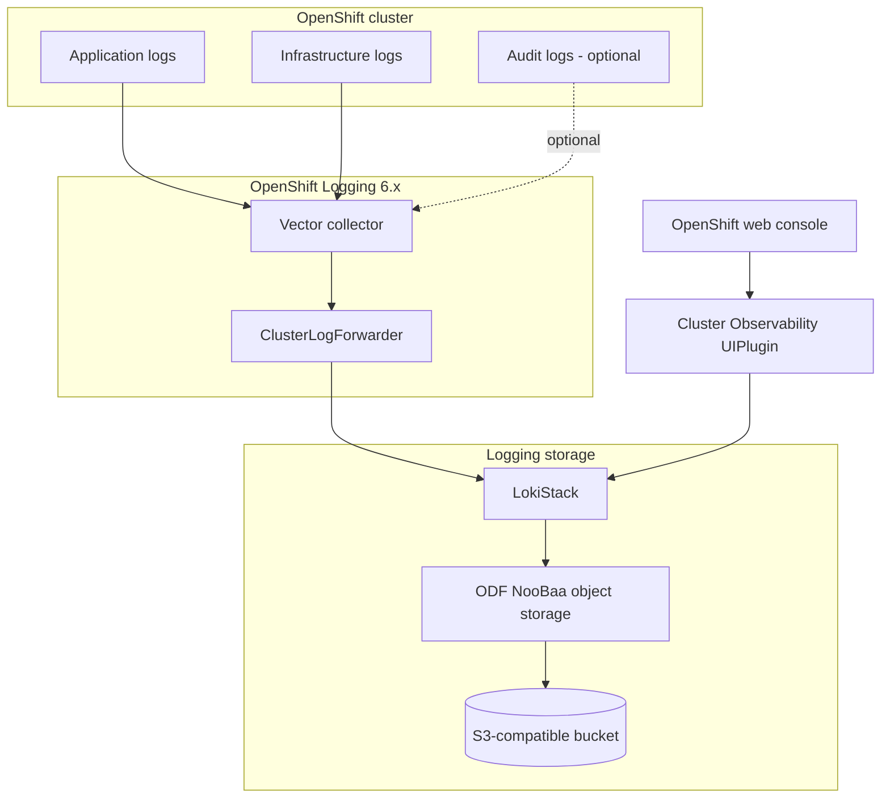
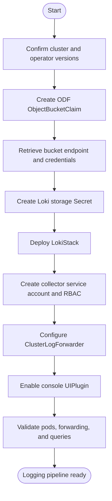
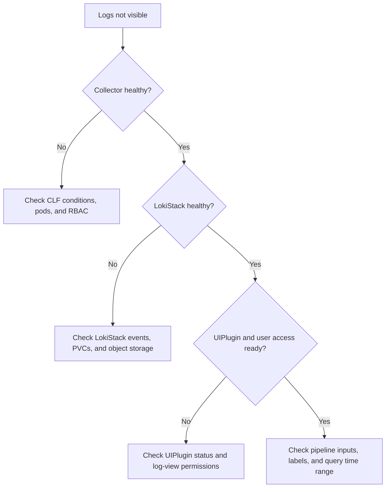

# Deploy OpenShift Logging 6.x with LokiStack and OpenShift Data Foundation

> **Hands-on technical guide | OpenShift Logging 6.x | LokiStack | ODF NooBaa**
>
> Configure centralized application and infrastructure logging on OpenShift using LokiStack and S3-compatible object storage provided by OpenShift Data Foundation (ODF).

## Introduction

Centralized logging is an important part of operating and troubleshooting an OpenShift cluster. It brings application and infrastructure logs into a common place, making it easier for platform administrators and application teams to investigate events and operational issues.

In this hands-on guide, I walk through a lab implementation that combines the Red Hat OpenShift Logging Operator, LokiStack, and ODF NooBaa object storage. The procedure covers object-storage provisioning, LokiStack configuration, log collection and forwarding, and access to logs through the OpenShift web console.

The examples are based on the configuration approach documented here. Operator APIs and supported combinations can change between releases, so check the compatibility notes before applying the manifests in your own environment.

> [!NOTE]
> **Lab reference:** The commands and manifests are examples. Confirm operator compatibility and validate them in a non-production cluster before adapting them for production.

## Contents

- [Introduction](#introduction)
- [Overview](#overview)
- [Architecture](#architecture)
- [Prerequisites](#prerequisites)
- [Deployment workflow](#deployment-workflow)
- [Implementation](#implementation)
- [Technical verification notes](#technical-verification-notes)
- [Conclusion](#conclusion)
- [SEO description and tags](#seo-description-and-tags)
- [Troubleshooting](#troubleshooting-checklist)
- [Version and support considerations](#important-version-and-support-considerations)
- [References](#references)

## Overview

OpenShift Logging can collect application, infrastructure, and audit logs. LokiStack provides the log storage backend, while OpenShift Data Foundation (ODF) can provide S3-compatible object storage through NooBaa.

This walkthrough covers:

1. Installing the required operators.
2. Creating an ObjectBucketClaim (OBC) in ODF.
3. Creating the Loki object-storage secret.
4. Deploying a LokiStack instance.
5. Configuring the log collector and ClusterLogForwarder.
6. Enabling the OpenShift console logging view.
7. Validating log collection and access.

## Architecture

The following diagram shows the main data path and the relationship between the OpenShift console, LokiStack, and ODF object storage.



| Component | Responsibility |
|---|---|
| Vector | Collects logs from cluster workloads and nodes |
| ClusterLogForwarder | Defines log inputs, outputs, and pipelines |
| LokiStack | Stores and indexes log metadata for querying |
| ODF NooBaa | Provides S3-compatible object storage |
| UIPlugin | Enables the logging experience in the OpenShift console |

## Prerequisites

Before starting, make sure you have:

- An OpenShift Container Platform cluster with administrator access.
- The OpenShift CLI (`oc`) installed and authenticated.
- OpenShift Data Foundation deployed and configured for object storage.
- The Red Hat OpenShift Logging Operator installed.
- The Loki Operator installed.
- The Cluster Observability Operator installed if you want the console logging view.
- Sufficient storage capacity and a suitable block StorageClass for Loki's temporary storage.

> **Version note:** OpenShift Logging has an independent release cycle from OpenShift Container Platform. Confirm the supported operator versions and APIs for your cluster before applying these examples. The modern examples below use the `observability.openshift.io/v1` ClusterLogForwarder API used by Logging 6.x. They are not interchangeable with the legacy `logging.openshift.io` ClusterLogging and ClusterLogForwarder APIs.

## Deployment workflow

Use this high-level workflow to track the implementation from storage provisioning through log validation.



## Implementation

The following steps build the logging stack in sequence. Complete each validation step before moving to the next component.

### Phase 1 — Provision object storage

#### 1. Create an ObjectBucketClaim

Create an OBC in the `openshift-logging` namespace. ODF NooBaa provisions an S3-compatible bucket and generates the associated configuration and credentials.

Save the following manifest as `obc-loki.yaml`:

```yaml
apiVersion: objectbucket.io/v1alpha1
kind: ObjectBucketClaim
metadata:
  name: loki-bucket-odf
  namespace: openshift-logging
spec:
  generateBucketName: loki-bucket-odf
  storageClassName: openshift-storage.noobaa.io
```

Apply the manifest and list the ObjectBucketClaims in the logging namespace:

```bash
oc apply -f obc-loki.yaml
oc get obc -n openshift-logging
```

- `oc apply -f` creates the ObjectBucketClaim from the YAML file, or updates it if it already exists.
- `oc get obc` displays the OBC status so you can confirm that provisioning has completed.

**Expected result:** The `loki-bucket-odf` claim should reach the `Bound` state. Do not continue until it is bound.

#### 2. Retrieve the bucket details and credentials

The OBC creates a ConfigMap containing the bucket endpoint information and a Secret containing the access credentials.

Run the following commands to read the bucket connection details from the OBC-generated ConfigMap and credentials from its Secret. The values are stored in shell variables for use in the next step:

```bash
BUCKET_HOST=$(oc get -n openshift-logging configmap loki-bucket-odf \
  -o jsonpath='{.data.BUCKET_HOST}')

BUCKET_NAME=$(oc get -n openshift-logging configmap loki-bucket-odf \
  -o jsonpath='{.data.BUCKET_NAME}')

BUCKET_PORT=$(oc get -n openshift-logging configmap loki-bucket-odf \
  -o jsonpath='{.data.BUCKET_PORT}')

ACCESS_KEY_ID=$(oc get -n openshift-logging secret loki-bucket-odf \
  -o jsonpath='{.data.AWS_ACCESS_KEY_ID}' | base64 -d)

SECRET_ACCESS_KEY=$(oc get -n openshift-logging secret loki-bucket-odf \
  -o jsonpath='{.data.AWS_SECRET_ACCESS_KEY}' | base64 -d)
```

**What the commands do:** The `oc get` commands read individual ConfigMap and Secret fields with JSONPath. The `base64 -d` commands decode the Secret data before assigning it to shell variables.

**Security:** Keep these credentials secure. Do not print them in terminal recordings, commit them to Git, or include them in screenshots. Avoid enabling shell tracing (`set -x`) while handling credentials.

#### 3. Create the Loki object-storage Secret

Create a Secret containing the ODF bucket details. The secret name used here is `logging-loki-odf`.

```bash
oc create secret generic logging-loki-odf \
  -n openshift-logging \
  --from-literal=access_key_id="${ACCESS_KEY_ID}" \
  --from-literal=access_key_secret="${SECRET_ACCESS_KEY}" \
  --from-literal=bucketnames="${BUCKET_NAME}" \
  --from-literal=endpoint="https://${BUCKET_HOST}:${BUCKET_PORT}"
```

Create the Secret using the bucket details and credentials retrieved in the previous step. Each `--from-literal` option sets one key in the Secret:

- `access_key_id`: the ODF access key.
- `access_key_secret`: the ODF secret key.
- `bucketnames`: the provisioned bucket name.
- `endpoint`: the S3-compatible endpoint, including its port.

Verify that the Secret exists without displaying its contents:

```bash
oc get secret logging-loki-odf -n openshift-logging
```

### Phase 2 — Configure Loki storage

#### 4. Deploy the LokiStack instance

Create a LokiStack custom resource that references the ODF object-storage Secret.

Save the following manifest as `lokistack.yaml`:

```yaml
apiVersion: loki.grafana.com/v1
kind: LokiStack
metadata:
  name: logging-loki
  namespace: openshift-logging
spec:
  size: 1x.demo
  storage:
    schemas:
      - effectiveDate: "2023-10-15"
        version: v13
    secret:
      name: logging-loki-odf
      type: s3
  storageClassName: <block-storage-class>
  tenants:
    mode: openshift-logging
```

Replace `<block-storage-class>` with the name of a suitable block StorageClass available in your cluster. The placeholder is not a literal value and must be replaced before applying the manifest.

List the StorageClasses available in the cluster with:

```bash
oc get storageclass
```

The `1x.demo` size is intended for demonstration and testing, not production use. Select a supported production size based on your expected ingestion volume, query load, and availability requirements.

Apply the LokiStack manifest. The following commands create the custom resource and then display the LokiStack and pods in the logging namespace:

```bash
oc apply -f lokistack.yaml
oc get lokistack -n openshift-logging
oc get pods -n openshift-logging
```

**Expected result:** The LokiStack resource should be accepted and its required components should become ready. Check the resource status and pod conditions before configuring log forwarding; the presence of the custom resource alone does not confirm that storage is working.

### Phase 3 — Configure log collection and forwarding

#### 5. Create the collector service account and grant permissions

For Logging 6.x, create a dedicated service account for the collector and grant only the log collection permissions required by your environment. The commands below create the account in `openshift-logging` and bind the named cluster roles to that service account.

```bash
oc create serviceaccount collector -n openshift-logging

oc adm policy add-cluster-role-to-user collect-application-logs \
  system:serviceaccount:openshift-logging:collector

oc adm policy add-cluster-role-to-user collect-infrastructure-logs \
  system:serviceaccount:openshift-logging:collector
```

If you also need audit logs, grant the audit collection role:

```bash
oc adm policy add-cluster-role-to-user collect-audit-logs \
  system:serviceaccount:openshift-logging:collector
```

Grant only the roles required for the log types you intend to collect.

#### 6. Configure the ClusterLogForwarder

With Logging 6.x, use the `observability.openshift.io/v1` API for the ClusterLogForwarder.

Save the following manifest as `clusterlogforwarder.yaml`:

```yaml
apiVersion: observability.openshift.io/v1
kind: ClusterLogForwarder
metadata:
  name: collector
  namespace: openshift-logging
spec:
  serviceAccount:
    name: collector
  outputs:
    - name: lokistack-out
      type: lokiStack
      lokiStack:
        target:
          name: logging-loki
          namespace: openshift-logging
        authentication:
          token:
            from: serviceAccount
      tls:
        ca:
          key: service-ca.crt
          configMapName: openshift-service-ca.crt
  pipelines:
    - name: default-logstore
      inputRefs:
        - application
        - infrastructure
        # Add audit only if the collector has the required permission.
        # - audit
      outputRefs:
        - lokistack-out
```

The manifest defines the collector service account, the LokiStack output, the authentication method, the TLS CA reference, and the pipeline inputs and outputs.

Apply the manifest:

```bash
oc apply -f clusterlogforwarder.yaml
oc get clusterlogforwarder -n openshift-logging
oc describe clusterlogforwarder collector -n openshift-logging
```

**What to check:** Review the ClusterLogForwarder conditions and collector pod status. A successfully created custom resource does not, by itself, prove that log data is reaching LokiStack. Confirm collector health and verify that logs can be queried.

### Phase 4 — Enable visualization and validate

#### 7. Enable the logging view in the OpenShift console

If the logging view is not already enabled, create a UIPlugin resource.

Save the following manifest as `uiplugin-logging.yaml`:

```yaml
apiVersion: observability.openshift.io/v1alpha1
kind: UIPlugin
metadata:
  name: logging
spec:
  type: Logging
  logging:
    lokiStack:
      name: logging-loki
```

The UIPlugin connects the OpenShift console logging experience to the LokiStack instance named `logging-loki`. The exact API version and fields must match the installed Cluster Observability Operator release.

Apply the manifest:

```bash
oc apply -f uiplugin-logging.yaml
oc get uiplugin logging
```

The UIPlugin API version and availability depend on the installed Cluster Observability Operator release. Verify compatibility with your cluster before applying it.

#### 8. Validate log collection

Check the relevant resources:

```bash
oc get pods -n openshift-logging
oc get lokistack -n openshift-logging
oc get clusterlogforwarder -n openshift-logging
oc get uiplugin logging
```

Then open the OpenShift web console and navigate to **Observe → Logs**. Select the relevant log type and query the logs.

**Expected result:** Logs from the configured inputs should be available for the selected time range, subject to the user's permissions and the pipeline configuration.

By default, application and infrastructure logs are included in the example pipeline. Audit logs require the additional collector permission and the `audit` input to be enabled.

### Advanced configuration: retention

Loki supports stream-based retention policies. The following example illustrates a seven-day retention period for logs matching the `build-ci` namespace selector, while the global retention period is 30 days.

Review the retention configuration against your Loki Operator version and operational requirements before applying it. In this example, the global retention period is 30 days, while the matching `build-ci` stream selector has a seven-day retention period:

```yaml
spec:
  limits:
    global:
      retention:
        days: 30
        streams:
          - selector: '{kubernetes_namespace_name="build-ci"}'
            priority: 1
            days: 7
```

Retention policies must be planned together with object-storage lifecycle policies. Confirm that the resulting retention behavior meets your data governance and compliance requirements.

## Troubleshooting checklist

Use this quick decision path to isolate common deployment issues:



| Symptom | What to check |
|---|---|
| OBC is not Bound | ODF object-storage health, NooBaa, and the OBC StorageClass |
| LokiStack pods are not ready | LokiStack events, storage class, resource requests, and object-storage credentials |
| Collector pods are failing | ClusterLogForwarder conditions, service-account permissions, and collector logs |
| No logs appear in the console | ClusterLogForwarder pipeline, LokiStack readiness, UIPlugin status, and user log-view permissions |
| S3 connection or authentication errors | Bucket endpoint, bucket name, Secret keys, and ODF object-storage health |

Use the following commands to inspect the OBC, LokiStack, ClusterLogForwarder, and recent events. `describe` provides resource details and events; `get events` helps identify recent namespace-level warnings and failures:

```bash
oc describe obc loki-bucket-odf -n openshift-logging
oc describe lokistack logging-loki -n openshift-logging
oc describe clusterlogforwarder collector -n openshift-logging
oc get events -n openshift-logging --sort-by=.lastTimestamp
```

## Important version and support considerations

- OpenShift Logging and OpenShift Container Platform have separate release cycles. Confirm the supported operator and platform combination.
- Logging 6.x uses the `observability.openshift.io/v1` ClusterLogForwarder API. Do not copy legacy `logging.openshift.io` ClusterLogging or ClusterLogForwarder examples into a Logging 6.x deployment.
- `1x.demo` is for demonstration only. Size production Loki deployments according to the official sizing guidance.
- The managed Loki deployment is intended for short-term log storage. Plan external retention and archival separately when long-term retention is required.
- These manifests are examples. Validate the API fields, StorageClass, operator versions, and resource sizing in a non-production environment before using them in production.

## Technical verification notes

The following items are environment- or release-dependent. Verify them against the documentation for the exact operator versions installed in your cluster before applying the examples:

1. **Operator compatibility:** Confirm that the OpenShift Container Platform version is supported by the installed OpenShift Logging, Loki, and Cluster Observability Operators.
2. **Object storage Secret mapping:** Confirm that the OBC-generated Secret contains the expected credential keys and that the LokiStack Secret format matches the installed Loki Operator release.
3. **StorageClass:** Replace `<block-storage-class>` with a real StorageClass supported for the LokiStack deployment. The example intentionally uses a placeholder.
4. **ClusterLogForwarder API and fields:** Confirm that `observability.openshift.io/v1` is served by your installed Logging 6.x release and that the output, authentication, and TLS fields match that release's API schema.
5. **UIPlugin API:** Confirm that `observability.openshift.io/v1alpha1` and the `Logging` plugin configuration are supported by your Cluster Observability Operator release.
6. **Retention configuration:** Validate the stream selector and retention fields against the LokiStack CRD and Loki Operator version in your environment.
7. **Demonstration sizing:** `1x.demo` is a demonstration profile. Do not use it as a production sizing recommendation.

These notes are deliberate verification points, not claims that the sample configuration is incorrect. The manifests have not been validated against every possible operator and OpenShift release combination.

## Conclusion

This guide has documented a hands-on workflow for configuring centralized logging on OpenShift with LokiStack and ODF NooBaa object storage. It covers the main stages: provisioning the object bucket, configuring LokiStack, setting up the collector and ClusterLogForwarder, enabling the console logging view, and validating the result.

Use the examples as a starting point for a lab deployment. Before using the same approach in production, verify the operator compatibility, storage configuration, RBAC permissions, retention requirements, and resource sizing for your environment.

## SEO description and tags

**SEO description:** Step-by-step guide to configuring OpenShift Logging 6.x with LokiStack and OpenShift Data Foundation (ODF) NooBaa object storage. Includes OBC setup, YAML manifests, ClusterLogForwarder configuration, validation, and troubleshooting.

**Suggested tags:** `Red Hat OpenShift`, `OpenShift Logging`, `LokiStack`, `OpenShift Data Foundation`, `ODF`, `NooBaa`, `ClusterLogForwarder`, `Kubernetes Logging`, `Cloud-Native`, `DevOps`

## References

- [Red Hat OpenShift Logging 6.2 – Configuring logging](https://docs.redhat.com/en/documentation/red_hat_openshift_logging/6.2/html-single/configuring_logging/index)
- [Red Hat OpenShift Logging 6.2 – Installing logging](https://docs.redhat.com/en/documentation/red_hat_openshift_logging/6.2/html-single/installing_logging/index)
- [OpenShift Container Platform 4.16 – Logging](https://docs.redhat.com/en/documentation/openshift_container_platform/4.16/html-single/logging/logging)
- [Red Hat Knowledgebase – Logging articles](https://access.redhat.com/)

---

**Author's note:** This article captures a hands-on lab workflow and the configuration examples used to explain the implementation. Always verify the configuration against the exact OpenShift and operator versions running in your environment.
