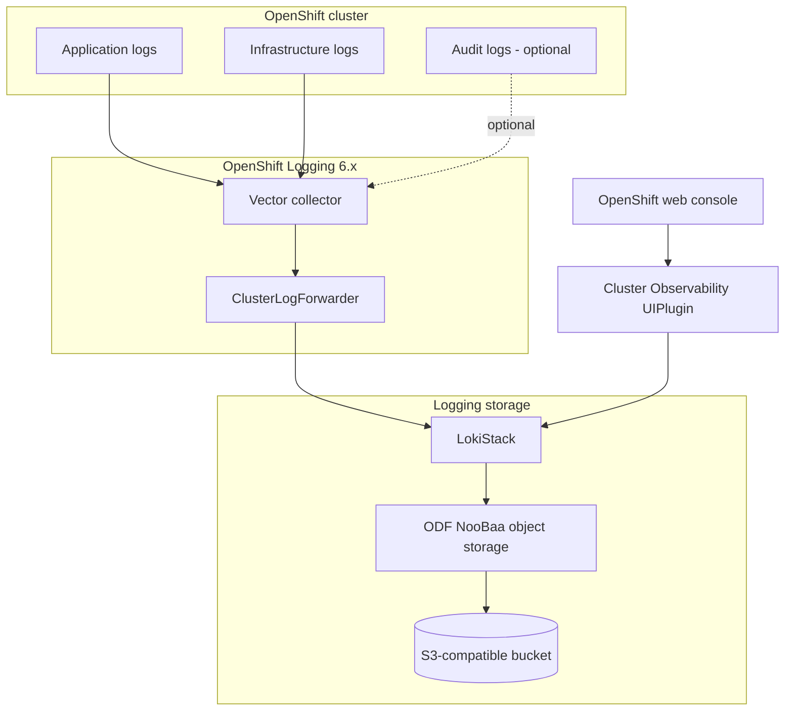
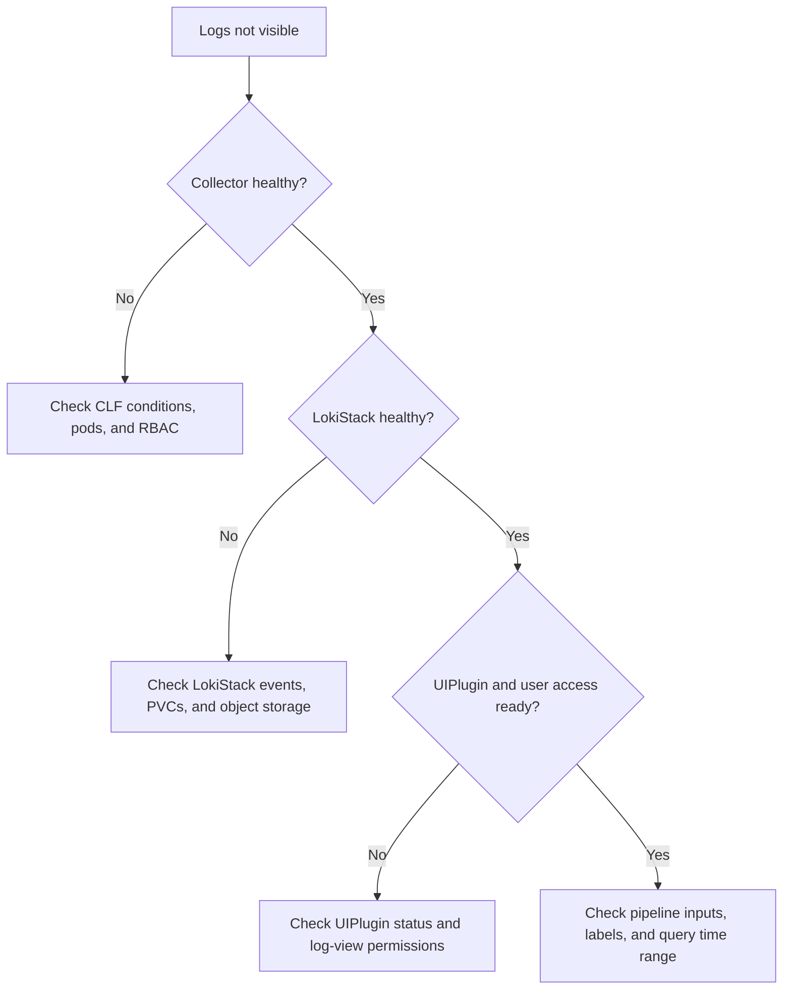

# Configure OpenShift Logging with LokiStack and OpenShift Data Foundation

> **Technical guide | OpenShift Logging 6.x | LokiStack | OpenShift Data Foundation (ODF)**
>
> This guide documents an example deployment that uses ODF NooBaa object storage for Loki log data and the OpenShift Logging 6.x APIs for log collection and visualization.

> [!NOTE]
> **Lab reference:** The commands and manifests are examples. Confirm operator compatibility and validate them in a non-production cluster before adapting them for production.

## Contents

- [Overview](#overview)
- [Architecture](#architecture)
- [Prerequisites](#prerequisites)
- [Deployment workflow](#deployment-workflow)
- [Implementation](#implementation)
- [Troubleshooting](#troubleshooting-checklist)
- [Version and support considerations](#important-version-and-support-considerations)
- [References](#references)

## Overview

OpenShift Logging can collect application, infrastructure, and audit logs. LokiStack provides the log storage backend, while OpenShift Data Foundation (ODF) can provide S3-compatible object storage through NooBaa.

This walkthrough covers:

1. Installing the required operators.
2. Creating an ObjectBucketClaim (OBC) in ODF.
3. Creating the Loki object-storage secret.
4. Deploying a LokiStack instance.
5. Configuring the log collector and ClusterLogForwarder.
6. Enabling the OpenShift console logging view.
7. Validating log collection and access.

## Architecture

The following diagram shows the main data path and the relationship between the OpenShift console, LokiStack, and ODF object storage.



| Component | Responsibility |
|---|---|
| Vector | Collects logs from cluster workloads and nodes |
| ClusterLogForwarder | Defines log inputs, outputs, and pipelines |
| LokiStack | Stores and indexes log metadata for querying |
| ODF NooBaa | Provides S3-compatible object storage |
| UIPlugin | Enables the logging experience in the OpenShift console |

## Prerequisites

Before starting, make sure you have:

- An OpenShift Container Platform cluster with administrator access.
- The OpenShift CLI (`oc`) installed and authenticated.
- OpenShift Data Foundation deployed and configured for object storage.
- The Red Hat OpenShift Logging Operator installed.
- The Loki Operator installed.
- The Cluster Observability Operator installed if you want the console logging view.
- Sufficient storage capacity and a suitable block StorageClass for Loki's temporary storage.

> **Version note:** OpenShift Logging has an independent release cycle from OpenShift Container Platform. Confirm the supported operator versions and APIs for your cluster before applying these examples. The modern examples below use the `observability.openshift.io/v1` ClusterLogForwarder API used by Logging 6.x. They are not interchangeable with the legacy `logging.openshift.io` ClusterLogging and ClusterLogForwarder APIs.

## Deployment workflow

Use this high-level workflow to track the implementation from storage provisioning through log validation.


## Implementation

The following steps build the logging stack in sequence. Complete each validation step before moving to the next component.

### Step 1 — Provision object storage

## 1. Create an ObjectBucketClaim

Create an OBC in the `openshift-logging` namespace. ODF NooBaa provisions an S3-compatible bucket and generates the associated configuration and credentials.

Save the following manifest as `obc-loki.yaml`:

```yaml
apiVersion: objectbucket.io/v1alpha1
kind: ObjectBucketClaim
metadata:
  name: loki-bucket-odf
  namespace: openshift-logging
spec:
  generateBucketName: loki-bucket-odf
  storageClassName: openshift-storage.noobaa.io
```

Apply the manifest:

```bash
oc apply -f obc-loki.yaml
oc get obc -n openshift-logging
```

Wait until the ObjectBucketClaim is in the `Bound` state before continuing.

## 2. Retrieve the bucket details and credentials

The OBC creates a ConfigMap containing the bucket endpoint information and a Secret containing the access credentials.

Run the following commands to retrieve the values:

```bash
BUCKET_HOST=$(oc get -n openshift-logging configmap loki-bucket-odf \
  -o jsonpath='{.data.BUCKET_HOST}')

BUCKET_NAME=$(oc get -n openshift-logging configmap loki-bucket-odf \
  -o jsonpath='{.data.BUCKET_NAME}')

BUCKET_PORT=$(oc get -n openshift-logging configmap loki-bucket-odf \
  -o jsonpath='{.data.BUCKET_PORT}')

ACCESS_KEY_ID=$(oc get -n openshift-logging secret loki-bucket-odf \
  -o jsonpath='{.data.AWS_ACCESS_KEY_ID}' | base64 -d)

SECRET_ACCESS_KEY=$(oc get -n openshift-logging secret loki-bucket-odf \
  -o jsonpath='{.data.AWS_SECRET_ACCESS_KEY}' | base64 -d)
```

Keep the credentials secure. Do not print them in terminal recordings, commit them to Git, or include them in screenshots.

## 3. Create the Loki object-storage secret

Create a Secret containing the ODF bucket details. The secret name used here is `logging-loki-odf`.

```bash
oc create secret generic logging-loki-odf \
  -n openshift-logging \
  --from-literal=access_key_id="${ACCESS_KEY_ID}" \
  --from-literal=access_key_secret="${SECRET_ACCESS_KEY}" \
  --from-literal=bucketnames="${BUCKET_NAME}" \
  --from-literal=endpoint="https://${BUCKET_HOST}:${BUCKET_PORT}"
```

Verify that the Secret exists without displaying its contents:

```bash
oc get secret logging-loki-odf -n openshift-logging
```

### Step 2 — Configure Loki storage

## 4. Deploy the LokiStack instance

Create a LokiStack custom resource that references the ODF object-storage Secret.

Save the following manifest as `lokistack.yaml`:

```yaml
apiVersion: loki.grafana.com/v1
kind: LokiStack
metadata:
  name: logging-loki
  namespace: openshift-logging
spec:
  size: 1x.demo
  storage:
    schemas:
      - effectiveDate: "2023-10-15"
        version: v13
    secret:
      name: logging-loki-odf
      type: s3
  storageClassName: <block-storage-class>
  tenants:
    mode: openshift-logging
```

Replace `<block-storage-class>` with a suitable block StorageClass available in your cluster. Check available StorageClasses with:

```bash
oc get storageclass
```

The `1x.demo` size is intended for demonstration and testing, not production use. Select a supported production size based on your expected ingestion volume, query load, and availability requirements.

Apply the manifest and check the LokiStack:

```bash
oc apply -f lokistack.yaml
oc get lokistack -n openshift-logging
oc get pods -n openshift-logging
```

Wait for the LokiStack components to become ready before configuring log forwarding.

### Step 3 — Configure log collection and forwarding

## 5. Create the collector service account and grant permissions

For Logging 6.x, create a service account for the collector and grant only the log collection permissions required by your environment.

```bash
oc create serviceaccount collector -n openshift-logging

oc adm policy add-cluster-role-to-user collect-application-logs \
  system:serviceaccount:openshift-logging:collector

oc adm policy add-cluster-role-to-user collect-infrastructure-logs \
  system:serviceaccount:openshift-logging:collector
```

If you also need audit logs, grant the audit collection role:

```bash
oc adm policy add-cluster-role-to-user collect-audit-logs \
  system:serviceaccount:openshift-logging:collector
```

Grant only the roles required for the log types you intend to collect.

## 6. Configure the ClusterLogForwarder

With Logging 6.x, use the `observability.openshift.io/v1` API for the ClusterLogForwarder.

Save the following manifest as `clusterlogforwarder.yaml`:

```yaml
apiVersion: observability.openshift.io/v1
kind: ClusterLogForwarder
metadata:
  name: collector
  namespace: openshift-logging
spec:
  serviceAccount:
    name: collector
  outputs:
    - name: lokistack-out
      type: lokiStack
      lokiStack:
        target:
          name: logging-loki
          namespace: openshift-logging
        authentication:
          token:
            from: serviceAccount
      tls:
        ca:
          key: service-ca.crt
          configMapName: openshift-service-ca.crt
  pipelines:
    - name: default-logstore
      inputRefs:
        - application
        - infrastructure
        # Add audit only if the collector has the required permission.
        # - audit
      outputRefs:
        - lokistack-out
```

Apply the manifest:

```bash
oc apply -f clusterlogforwarder.yaml
oc get clusterlogforwarder -n openshift-logging
oc describe clusterlogforwarder collector -n openshift-logging
```

Check the ClusterLogForwarder conditions and collector pod status. A ready custom resource alone does not replace checking the collector logs and confirming that data reaches LokiStack.

### Step 4 — Enable visualization and validate

## 7. Enable the logging view in the OpenShift console

If the logging view is not already enabled, create a UIPlugin resource.

Save the following manifest as `uiplugin-logging.yaml`:

```yaml
apiVersion: observability.openshift.io/v1alpha1
kind: UIPlugin
metadata:
  name: logging
spec:
  type: Logging
  logging:
    lokiStack:
      name: logging-loki
```

Apply the manifest:

```bash
oc apply -f uiplugin-logging.yaml
oc get uiplugin logging
```

The UIPlugin API version and availability depend on the installed Cluster Observability Operator release. Verify compatibility with your cluster before applying it.

## 8. Validate log collection

Check the relevant resources:

```bash
oc get pods -n openshift-logging
oc get lokistack -n openshift-logging
oc get clusterlogforwarder -n openshift-logging
oc get uiplugin logging
```

Then open the OpenShift web console and navigate to **Observe → Logs**. Select the relevant log type and query the logs.

By default, application and infrastructure logs are included in the example pipeline. Audit logs require the additional collector permission and the `audit` input to be enabled.

## 9. Advanced configuration: retention

Loki supports stream-based retention policies. The following example illustrates a seven-day retention period for logs matching the `build-ci` namespace selector, while the global retention period is 30 days.

Review the retention configuration against your Loki Operator version and operational requirements before applying it:

```yaml
spec:
  limits:
    global:
      retention:
        days: 30
        streams:
          - selector: '{kubernetes_namespace_name="build-ci"}'
            priority: 1
            days: 7
```

Retention policies must be planned together with object-storage lifecycle policies. Confirm that the resulting retention behavior meets your data governance and compliance requirements.

## Troubleshooting checklist

Use this quick decision path to isolate common deployment issues:



| Symptom | What to check |
|---|---|
| OBC is not Bound | ODF object-storage health, NooBaa, and the OBC StorageClass |
| LokiStack pods are not ready | LokiStack events, storage class, resource requests, and object-storage credentials |
| Collector pods are failing | ClusterLogForwarder conditions, service-account permissions, and collector logs |
| No logs appear in the console | ClusterLogForwarder pipeline, LokiStack readiness, UIPlugin status, and user log-view permissions |
| S3 connection or authentication errors | Bucket endpoint, bucket name, Secret keys, and ODF object-storage health |

Useful commands:

```bash
oc describe obc loki-bucket-odf -n openshift-logging
oc describe lokistack logging-loki -n openshift-logging
oc describe clusterlogforwarder collector -n openshift-logging
oc get events -n openshift-logging --sort-by=.lastTimestamp
```

## Important version and support considerations

- OpenShift Logging and OpenShift Container Platform have separate release cycles. Confirm the supported operator and platform combination.
- Logging 6.x uses the `observability.openshift.io/v1` ClusterLogForwarder API. Do not copy legacy `logging.openshift.io` ClusterLogging or ClusterLogForwarder examples into a Logging 6.x deployment.
- `1x.demo` is for demonstration only. Size production Loki deployments according to the official sizing guidance.
- The managed Loki deployment is intended for short-term log storage. Plan external retention and archival separately when long-term retention is required.
- These manifests are examples. Validate the API fields, StorageClass, operator versions, and resource sizing in a non-production environment before using them in production.

## References

- [Red Hat OpenShift Logging 6.2 – Configuring logging](https://docs.redhat.com/en/documentation/red_hat_openshift_logging/6.2/html-single/configuring_logging/index)
- [Red Hat OpenShift Logging 6.2 – Installing logging](https://docs.redhat.com/en/documentation/red_hat_openshift_logging/6.2/html-single/installing_logging/index)
- [OpenShift Container Platform 4.16 – Logging](https://docs.redhat.com/en/documentation/openshift_container_platform/4.16/html-single/logging/logging)
- [Red Hat Knowledgebase – Logging articles](https://access.redhat.com/)

---

**Author's note:** This guide is based on a lab-oriented implementation pattern. Always verify the configuration against the exact OpenShift and operator versions running in your environment.
